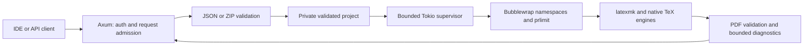

# Architecture

TexCompiler is a single Rust crate with an Axum/Tokio HTTP process and a
separate internal worker executable. Native TeX Live is authoritative; Rust
replaces API handling, input preparation and process orchestration rather than
the TeX typesetting algorithms. Both binaries are built and installed together.

## HTTP boundary

Legacy routes keep JSON inputs and binary PDF success responses. Versioned
aliases share that implementation. Request bodies are bounded at 32 MiB.
Remote listeners require a bearer token; health, readiness, engine inventory,
the IDE/static files and OpenAPI remain public. Authentication precedes project
parsing. Admission bounds concurrent requests and preparation; a cancelled
request cannot release the permit of still-running blocking ZIP work.

## Projects and assets

JSON assets and ZIP entries become an ordered map of project-relative byte
files. Validation enforces 256 files, 20 MiB decoded content, bounded portable
paths, no traversal/links/special files/duplicates or file-directory collisions.
Only validated regular files enter the private workspace. ZIP decompression is
bounded while reading, not merely by advertised sizes. Fonts and images remain
byte-preserving. The service never rewrites source to substitute fonts/packages.

## Worker lifecycle

Each compiler instance shares two worker slots. The supervisor owns the slot,
private workspace, protocol streams and deadline through cancellation/reaping.
Bubblewrap creates private user/PID/mount/network/IPC/UTS namespaces, mounts
only the approved system/worker/project paths, clears the environment and drops
capabilities. Shell escape and latexmk rc loading are disabled. See the native
worker contract for exact limits and mounts.

latexmk orchestrates installed bibliography/multipass tools; the direct fallback
runs three TeX passes and does not promise bibliography support. Explicit engines
are never silently changed. Project basenames are retained as TeX job names.
PDF parsing/page counting happens inside the sandbox. The supervisor validates
the bounded typed result before returning raw PDF bytes. Final-run warnings
avoid reporting temporary first-pass reference warnings as final failures.

## Deployment boundary

The inner worker enforces namespaces and per-process limits. Compose adds
aggregate CPU/memory/PID/temp-storage limits and a non-root read-only container
policy. Host namespace/LSM policy is still required. Startup performs a real
compilation; /ready fails closed when it cannot run. No Python implementation
or interpreter is part of the Rust request path or assembled runtime image.

## Extension points

Keep api/, compiler/, config/ and workspace/ responsibilities separate. Add
cache/jobs/fonts/metrics modules only for implemented responsibilities. Persistent
caching, async job APIs and WASM are absent and must not be advertised as active.
WASM would require an independently reviewed existing TeX engine/runtime adapter;
Emscripten binaries must not be assumed to work as WASI. Native compatibility
remains available before any optional backend is accepted.
